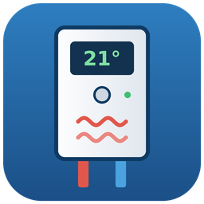
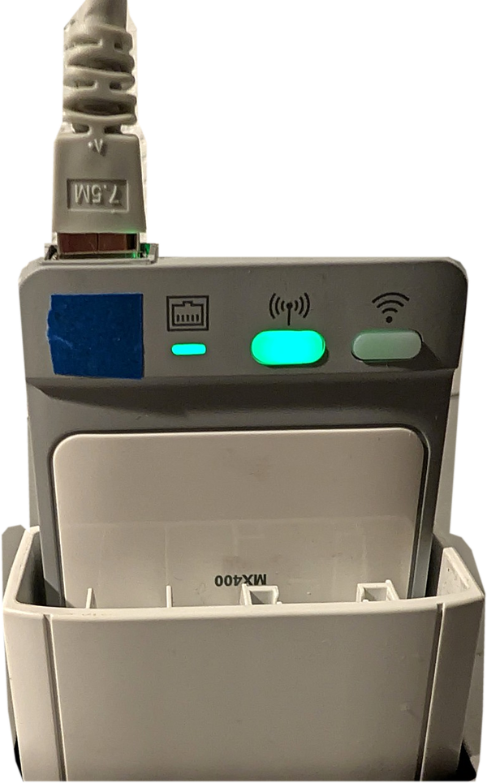
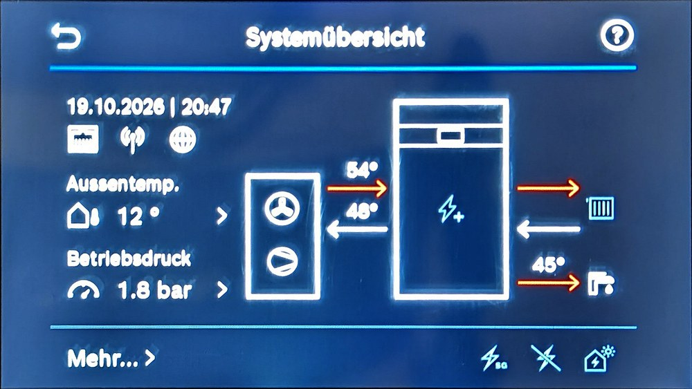

# ioBroker.buderus-mx400


[](LICENSE)
[](https://www.paypal.com/donate/?hosted_button_id=BW2WL8QCH2AMU)

**[🇩🇪 Deutsche Anleitung](docs/de/README.md)**

## Buderus MX400 adapter for ioBroker

This adapter reads the data of a **Buderus heat pump** via the official **local API** of the **LAN and radio module MX400**. The connection runs directly in your home network. No cloud account is needed.



*The Buderus LAN and radio module MX400 (connected via LAN). The adapter communicates with this module.*

The MX400 is the internet gateway and radio module of the heating system. It sits in a slot of the heat pump and connects it to the home network via LAN or Wi-Fi. According to the manufacturer, the same local API is also offered by the Bosch Connect-Key K 40 RF and the K 40 RF of IVT, Vulcano and Worcester. The adapter was developed and tested with a Buderus MX400.

Manufacturer: [Buderus](https://www.buderus.de) · [Product information on the MX400 (Buderus, PDF)](https://www.buderus.de/resource/blob/84532/5f174d97fdbaf3201210da560b2364a7/18_Buderus_ISH-2025_LAN-%20und-Funkmodul-MX400.pdf)

> **Note:** The manufacturer's API is currently **read-only**. The adapter can display all values, but it cannot change settings of the heat pump.

## Features

- **Reads all available values automatically.** At startup, the adapter checks every resource described in the manufacturer's API specification and creates data points only for those your system actually provides. In addition, all signals reported by the device itself are read.
- **German and English names** for all data points, with the correct units (°C, kWh, %, l/h …) and matching roles
- **Energy counters** (e.g. total consumption, heating, hot water) as separate data points for heat produced, compressor and electric heater
- **History data** for consumption, starts, working time and temperatures: daily values of the last 31 days, monthly values of the last 12 months, plus *today* and *this month*. Temperatures are shown as averages, energy values as totals.
- **Complex responses** such as error messages or system information are split into individual data points, and the complete response is also available as JSON.
- **Sensor special values** (short circuit, open circuit, flow too low …) are not shown as measured values, the data point stays empty instead.
- **Connection indicator** (`info.connection`) in the instance list
- **Gentle on the device:** values that rarely change (history data, Wi-Fi list) are only read once per hour. Resources that did not answer during startup are retried hourly.



*The system overview on the display of the heat pump. Values such as outdoor temperature, flow and return temperature, hot water temperature and operating pressure are also available in ioBroker.*

## Requirements

- Buderus heat pump with the **LAN and radio module MX400** (or another supported K 40 RF gateway) with **gateway firmware 15.00.01 or newer**
- The MX400 and ioBroker must be in the same local network.
- An **API token** for the MX400 (see below)
- ioBroker with js-controller 6.0.11 or newer and Admin 7.0.23 or newer
- Node.js 20 or newer (Node.js 22 or newer recommended)

## Creating the API token

The token is created **once** with the `Login` and `Pass` values from the sticker or information sheet of the MX400. The token does not expire, so store it safely and treat it like a password.

Short summary of the manufacturer's guide:

1. Find the IP address of the MX400 in your router.
2. Remove all hyphens from the `Pass` value.
3. Press the **WLAN** and **Wireless** buttons on the MX400 at the same time for one second. The LEDs briefly flash blue.
4. **Within 5 minutes**, request the token (port 9442):

    ```bash
    curl --insecure --request POST "https://IP-ADDRESS:9442/auth/token" \
      --header "Content-Type: application/x-www-form-urlencoded" \
      --data-urlencode "grant_type=password" \
      --data-urlencode "username=LOGIN" \
      --data-urlencode "password=PASS-WITHOUT-HYPHENS" \
      --data-urlencode "client_name=iobroker"
    ```

    On Windows (PowerShell), write `curl.exe` instead of `curl` and put the command on a single line without the `\`.

5. Copy the value of `access_token` from the response.

The complete guide with troubleshooting: [K 40 RF API documentation (Bosch Home Comfort)](https://github.com/bosch-home-comfort/api-docs/blob/main/docs/k-40-rf.md)

## Installation

As long as the adapter is not available in the official ioBroker repository, install it via npm or GitHub:

1. In the ioBroker Admin, open **Adapters**.
2. Click the **GitHub icon** ("Install from custom URL") in the toolbar.
3. Either enter the package name `iobroker.buderus-mx400` on the **npm** tab, or enter `https://github.com/septa-cr/ioBroker.buderus-mx400` on the **Custom** tab, and confirm.
4. Create an instance of the adapter.

Alternatively, on the command line: `iob url iobroker.buderus-mx400`

## Configuration

| Setting | Description |
| --- | --- |
| IP address of the MX400 | IP address of the MX400 in your network, e.g. `192.168.178.135` |
| API token | The token created as described above. It is stored encrypted. |
| Polling interval (seconds) | How often the values are read. Default 60, minimum 10 |

At the first start, the adapter checks all resources of the API. This takes about one to two minutes. The log then shows how many resources your system provides, for example: *"Search completed: 1286 paths checked, 118 present …"*.

## Data points

| Folder | Content |
| --- | --- |
| `info.connection` | Connection to the MX400 (true/false) |
| `signals.*` | All signals reported by the device, e.g. outdoor temperature, flow temperature, compressor speed |
| `heatSources.*` | Heat pump: temperatures, compressor power, system pressure, energy counters |
| `heatingCircuits.hc1.*` | Heating circuit 1: room temperature, setpoints, pump and status |
| `dhwCircuits.dhw1.*` | Hot water: temperature, setpoint, status |
| `devices.device1.*` | Paired radio devices, e.g. room controllers |
| `recordings.*` | History data (`daily`, `monthly`, `today`, `thisMonth`) |
| `system.*`, `gateway.*`, `notifications.*` | System information, gateway, error messages |

Which folders and values appear depends on your system.

## Security notes

- The MX400 uses a self-signed certificate. As recommended by the manufacturer, the adapter therefore does not verify the certificate for this connection only. The data is still transmitted encrypted. Use the adapter only in a trusted local network.
- The token is stored encrypted in ioBroker and is only made available to the adapter itself.

## Support the development

Do you like this adapter? You can support its development with a coffee donation:

[](https://www.paypal.com/donate/?hosted_button_id=BW2WL8QCH2AMU)

## Disclaimer

This adapter is a private project and is not affiliated with Bosch Thermotechnik GmbH or Buderus. All product and company names are trademarks of their respective owners. Use at your own risk.

## Changelog

<!--
    Placeholder for the next version (at the beginning of the line):
    ### **WORK IN PROGRESS**
-->

### 0.0.3 (2026-10-23)

- (septa-cr) The settings page is now translated into all languages
- (septa-cr) More precise state roles for energy counters (`value.power.consumption`)
- (septa-cr) Minimum Node.js version documented

### 0.0.2 (2026-10-22)

- (septa-cr) Corrected the package description (LAN and radio module MX400)

### 0.0.1 (2026-10-18)

- (septa-cr) Initial release: reads all values of the Buderus MX400 LAN and radio module via the local API (signals, energy counters, history data), German and English data point names, connection indicator

## License

MIT License

Copyright (c) 2026 septa-cr <98657393+septa-cr@users.noreply.github.com>

Permission is hereby granted, free of charge, to any person obtaining a copy
of this software and associated documentation files (the "Software"), to deal
in the Software without restriction, including without limitation the rights
to use, copy, modify, merge, publish, distribute, sublicense, and/or sell
copies of the Software, and to permit persons to whom the Software is
furnished to do so, subject to the following conditions:

The above copyright notice and this permission notice shall be included in all
copies or substantial portions of the Software.

THE SOFTWARE IS PROVIDED "AS IS", WITHOUT WARRANTY OF ANY KIND, EXPRESS OR
IMPLIED, INCLUDING BUT NOT LIMITED TO THE WARRANTIES OF MERCHANTABILITY,
FITNESS FOR A PARTICULAR PURPOSE AND NONINFRINGEMENT. IN NO EVENT SHALL THE
AUTHORS OR COPYRIGHT HOLDERS BE LIABLE FOR ANY CLAIM, DAMAGES OR OTHER
LIABILITY, WHETHER IN AN ACTION OF CONTRACT, TORT OR OTHERWISE, ARISING FROM,
OUT OF OR IN CONNECTION WITH THE SOFTWARE OR THE USE OR OTHER DEALINGS IN THE
SOFTWARE.
